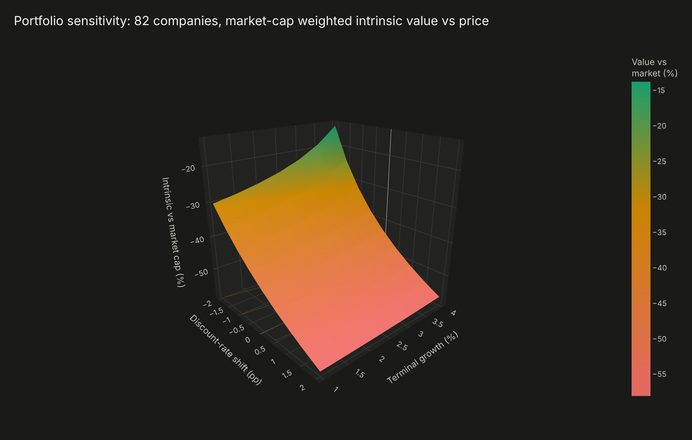
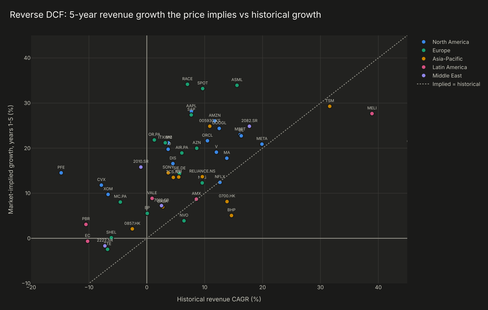
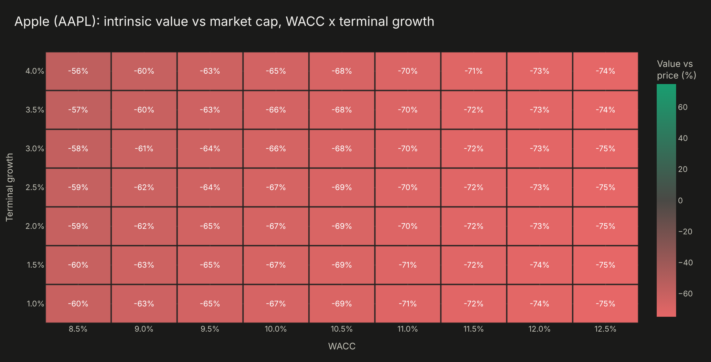
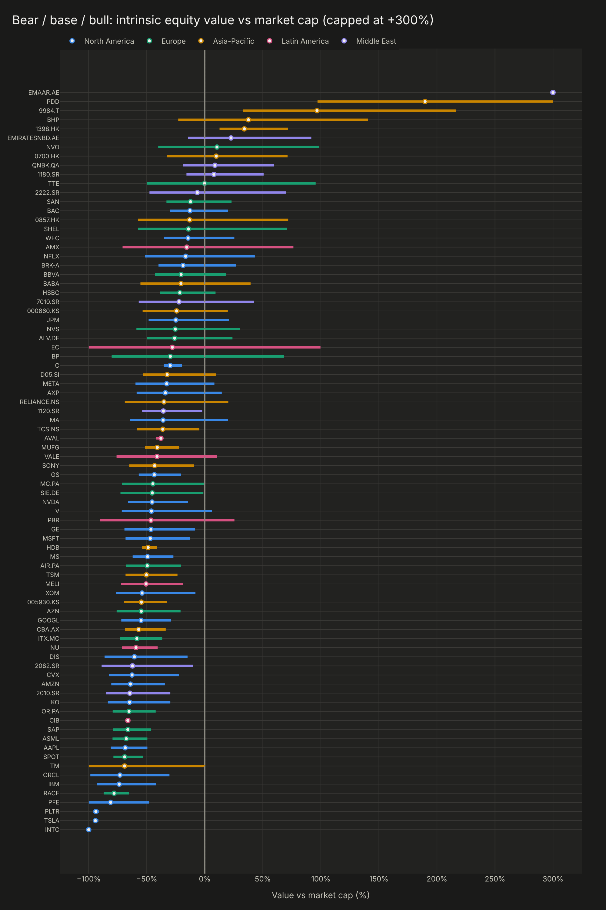

# DCF with Scenarios: 82 Global Companies

How much is a company really worth, and how sensitive is that value to the assumptions?

This project values 82 large companies from the US, Europe, Latin America, the Middle East and Asia-Pacific. Each one is valued on its own. It has four parts:
- **Python valuation engine.** A free cash flow to the firm (FCFF) DCF for operating companies, and an excess-return model for banks, insurers and holding companies.
- **Scenarios and sensitivity.** Bear, base and bull cases for every company, plus a sensitivity grid of discount rate x terminal growth.
- **Reverse DCF.** For each company, the 5-year revenue growth that the current price implies.
- **One Excel model per company.** 82 workbooks with live formulas. They reproduce the Python results to the sixth decimal.

All numbers come from outputs/metrics.json.



## Key findings

The data is as of 13 November 2026. The US 10-year Treasury yield is 5.14%, and the mature-market equity risk premium is 4.23%.

**1. On historical fundamentals, the market prices this universe well above a standard DCF.**

| | Bear | Base | Bull |
|---|---|---|---|
| Intrinsic value vs market cap, market-cap weighted | -66.8% | -45.8% | -10.1% |
| Median company | -66.6% | -42.2% | -1.7% |
| Companies with value above market cap (of 82) | 4 | 10 | 39 |

The median discount rate is 9.4%.

**2. Prices imply much faster growth than history.**
- For 52 operating companies the model can solve for the growth the price implies. The median company needs 16.2% revenue growth a year for five years to justify its price.
- The median historical growth rate is 7.0%.
- In 44 of the 52 companies, the growth the price implies is above historical growth.



**3. The mega-caps are priced for growth they have not shown yet.**

| Company | Price-implied growth | Historical growth | Base-case value vs market cap |
|---|---|---|---|
| Apple | 28.1% | 7.7% | -69% |
| ASML | 33.9% | 15.6% | -68% |
| Ferrari | 34.2% | 7.0% | -78% |
| Microsoft | 23.0% | 16.1% | -47% |

**4. Discount rates matter more than terminal growth.**
- Long-run growth is reinvested at a return only 3 points above WACC, so a higher terminal g adds little value.
- Portfolio-wide, moving every discount rate from -2 to +2 points moves value from -30% to -58% vs market, with terminal growth fixed at 1%.
- Moving terminal growth from 1% to 4% moves value by at most 16 points.
- Apple's grid runs from -56% (WACC 8.5%, g 4%) to -75% (WACC 12.5%, g 1%). The price is not justified anywhere on it.



**5. The cheap end of the list is energy, Chinese platforms, Gulf banks and companies trading below book.**
- Base-case value above market cap: PDD (+190%), ICBC (+34%), BHP (+38%), Emirates NBD (+23%), Novo Nordisk (+10%), Tencent (+10%), SNB (+8%) and QNB (+9%).
- TotalEnergies, Aramco and Shell sit close to fair value. The growth their prices imply is about zero or negative.
- The Middle East has the highest median base case, at -6%.

**6. Growth destroys value when returns are below the cost of capital.**
- Five financials earn an ROE below their cost of equity: Citigroup, Grupo Cibest (Bancolombia), Grupo Aval, ICBC and HDFC Bank.
- For Grupo Aval (ROE 5.2% vs cost of equity 11.5%), the bear case is worth more than the bull case.



**7. Some results are outliers, and they are reported as computed.**
- **Emaar (+550%):** two years of real-estate development profit, growing 40%, are extrapolated.
- **SoftBank (+97%):** its ROE includes investment gains.
- **Intel (-100%):** its EBIT margin over the last two years is negative, so equity value is floored at zero.
- **Tesla (-94%) and Palantir (-94%):** even 60% annual growth does not reach the price.

## Universe and data

- **Companies.** 82 of the 85 tickers in my personal watchlist.
  - International Holding Company, First Abu Dhabi Bank and e& have no fundamentals coverage in the data source, so they are excluded.
  - MELO is valued as MercadoLibre (MELI).
- **Financial statements.** Annual revenue, EBIT, D&A, capex, change in working capital, tax rate, net income, common equity, debt, cash and minority interest, from Yahoo Finance fundamentals-timeseries (`data/fundamentals.jsonl`).
  - US companies have four fiscal years; the rest have two.
  - Market caps are as of 13 November 2026.
- **Risk-free rate.** The US 10-year Treasury yield (CBOE ^TNX), 5.14%.
- **Risk premiums.** The equity risk premium and country risk premiums come from Damodaran, January 2026.
- **Betas.** Industry betas (unlevered, cash-corrected) come from Damodaran, January 2026.
- **FX.** ECB reference rates for 13 November 2026. TWD and COP come from Yahoo Finance; SAR, AED and QAR are at their official USD pegs.

## Method

**Currency.** Everything is converted to USD at spot FX. The discount rate is a USD rate: Rf + beta x mature ERP + country risk premium.

**FCFF DCF (57 companies)**
- **Growth.** For years 1-5, growth = 60% x historical CAGR + 40% x 4%, capped between -3% and 15%. It fades linearly to terminal growth by year 10.
- **Margin.** The EBIT margin is the average of the last two years. The tax rate is the average effective rate, bounded between 10% and 35%.
- **Reinvestment.**
  - It starts at the historical (capex - D&A - change in WC) / NOPAT.
  - It converges to g / RONIC by year 10, where RONIC = WACC + 3 pp.
- **Terminal value.** Terminal value = NOPAT11 x (1 - g / RONIC) / (WACC - g).
- **Equity value.** Equity = EV - debt + cash - minority interest, floored at zero.
- **Beta.** The beta is relevered with Hamada, then Blume-adjusted.
- **Cost of debt.** The cost of debt is Rf + country risk premium + a spread that depends on leverage.

**Excess-return model (25 banks, insurers and holding companies)**
- **Value.** Equity = book value + PV of (ROE - Ke) x beginning book.
- **ROE.** ROE fades linearly from the last two years' average to Ke + 50% of today's spread.
- **Book growth.** Book grows at 50% retention x ROE, capped at 10%, and fades to terminal g.

**Scenarios**

| | Bear | Base | Bull |
|---|---|---|---|
| Growth, years 1-5 | -4 pp | model | +4 pp |
| Margin or ROE | x 0.85 | model | x 1.10 |
| Discount rate | +1 pp | model | -1 pp |
| Terminal growth | 1.5% | 2.5% | 3.5% |

**Sensitivity.** The discount rate moves by -2 to +2 points in 0.5 pp steps, and terminal growth moves from 1% to 4%. That is a 9 x 7 grid per company.

**Reverse DCF.** A bisection solves for the year 1-5 growth that sets base-case equity value equal to market cap.

## Excel models

`excel/` has one workbook per company (for example `DCF_AAPL.xlsx`, `DCF_2222_SR.xlsx`). Each has four sheets:
- **Summary:** bear, base and bull value vs market cap, the method and the sources.
- **Inputs:** raw financials in the reporting currency, the derived history in USD, the assumptions, the discount-rate build-up and the scenario parameters.
- **Scenarios:** three 10-year projections with terminal value and the bridge to equity value.
- **Sensitivity:** the rate x terminal growth grid. Each cell re-runs the base-case model with SUMPRODUCT.

The colour code is: blue = input, black = formula, green = link to another sheet, yellow fill = key assumption.

Every workbook was recalculated with LibreOffice and has zero formula errors. All 82 x (3 scenarios + 63 grid cells) match the Python engine within 1e-6.

## Interactive dashboard

`dashboard.html` opens in any browser. You can:
- pick a company or a region;
- see the KPI tiles, the sensitivity heatmap, a 3D value surface, the 10-year FCFF or excess-return projection and the scenario bars against market cap;
- sort the full table, and click a row to load that company.

## Charts

| File | Content |
|---|---|
| `outputs/sensitivity_surface_3d` | Portfolio value vs market across discount-rate shift x terminal growth |
| `outputs/sensitivity_heatmap_featured` | Apple: WACC x terminal growth grid |
| `outputs/scenario_ranges` | Bear-base-bull range for all 82 companies |
| `outputs/implied_vs_historical_growth` | Reverse DCF vs historical growth |
| `outputs/rate_vs_upside` | Discount rate vs base-case value gap, bubble size = market cap |

## Repository structure

```
data/        fundamentals.jsonl, companies.csv, market_inputs.json
src/         model.py (engines), main.py (metrics), charts.py (charts + dashboard), build_excel.py
excel/       82 workbooks with live formulas
outputs/     metrics.json, PNG and HTML charts
tests/       12 tests (Gordon identity, book-value identity, monotonicity, reverse DCF, Excel parity)
dashboard.html
```

## How to run

```
pip install numpy plotly kaleido openpyxl pytest
cd src
python main.py          # outputs/metrics.json
python charts.py        # charts and dashboard.html
python build_excel.py   # excel/*.xlsx
cd .. && pytest -q
```

## Limitations

- **Short history.** Only two fiscal years are available outside the US, so growth and margins can be distorted by a single year. The growth shrinkage and caps reduce this but do not remove it.
- **Data quirks.**
  - Netflix's D&A includes content amortisation, while content spending is not in capex. This overstates its free cash flow.
  - Toyota's debt includes its captive finance arm.
  - Aramco's reported tax rate of 20% is below its true upstream rate.
  - ASML reports no D&A, so D&A is set equal to capex.
- **Mechanical rules.** Industry betas come from US data, and one rule applies to every company. A real analyst would adjust each company by hand. This is a screening model, not a price target.
- **Not investment advice.**

## Development process and use of AI

- **My role.** I chose the problem, the company universe (my own watchlist) and the split between Python and Excel. I reviewed the outputs and the conclusions.
- **AI's role.** I used Claude (Anthropic) as a coding assistant to:
  - collect the data;
  - write the valuation engines, the Excel builder, the charts and the dashboard;
  - draft this README.
- **How the work was checked.**
  - Every workbook was recalculated and compared cell by cell with the Python results.
  - Tests check the closed-form identities.
  - The outliers above were inspected and documented rather than tuned away.
